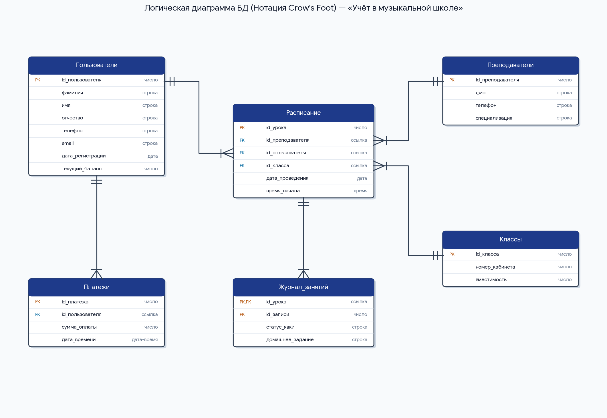

# Этап 3. Логическое проектирование — решение кейса «Учёт в музыкальной школе»

**Вход:** ER-модель этапа 2 — 6 сущностей (`Пользователь`, `Преподаватель`, `Класс`, `Урок (Расписание)`, `Журнал_занятий`, `Платёж`), 5 связей (1 идентифицирующая), связь `M:N` («Пользователь ↔ Преподаватель») преобразована в сущность `Урок (Расписание)`.  
**Выход:** реляционная схема из 6 таблиц в **3NF**. На схеме используются абстрактные типы данных (строка, число, дата, время, ссылка); конкретные типы СУБД и индексы будут определены на этапе 4.

---

## 1. Преобразование ER-модели по формальным правилам

| Правило | Как применено в проекте |
| :--- | :--- |
| **a) каждая сущность → таблица** | 6 сущностей → 6 реляционных таблиц |
| **b) атрибуты → колонки** | Все атрибуты этапов 1–2 перенесены в соответствующие колонки таблиц |
| **c) 1:M → внешний ключ на стороне «M»** | Связи «посещает», «ведёт», «проходит в» → внешние ключи `FK` в таблице `Расписание`; «вносит» → `FK` в `Платежи`; «фиксируется в» → `FK` в `Журнал_занятий`. Связей `1:1` в модели нет |
| **d) M:N → промежуточная таблица** | Решено на этапе 2: `Расписание` выступает промежуточной таблицей для связи `Пользователь — Преподаватель` |
| **e) атрибуты связи → колонки промежуточной таблицы** | `дата_проведения`, `время_начала` — колонки таблицы `Расписание` |
| **f) слабые сущности → составной ключ** | `Журнал_занятий`: составной `PK (id_урока, id_записи)` (ключ родителя + дискриминант) |
| **g) многозначный атрибут → отдельная таблица** | Многозначных атрибутов в модели нет (на этапе 1 принято решение хранить один основной телефон на профиль) |
| **h) составные атрибуты → несколько колонок** | ФИО пользователя разбито на `фамилия`, `имя`, `отчество` (решение этапа 1) |
| **i) производные атрибуты не хранятся** | Возраст ученика, количество проведённых уроков и остаток занятий по абонементу вычисляются в запросах (этап 5) |

> **Решение о ключах:** используются суррогатные первичные ключи (`ID_...`) для стабильности связей и ускорения `JOIN`-запросов, а естественные уникальные значения (`телефон`, `email`, `номер_кабинета`) защищены ограничением `UNIQUE`.

---

## 2. Реляционная схема (описания таблиц)

### Таблица `Пользователи`

| Колонка | Абстрактный тип | Ключ / ограничения |
| :--- | :--- | :--- |
| **id_пользователя** | число | `PK` (суррогатный) |
| **фамилия** | строка | `NOT NULL` |
| **имя** | строка | `NOT NULL` |
| **отчество** | строка | `NULL` допустим |
| **телефон** | строка | `NOT NULL`, `UNIQUE` (Б4) |
| **email** | строка | `NULL` допустим, `UNIQUE` (Б4) |
| **дата_регистрации** | дата | `NOT NULL` |
| **текущий_баланс** | число | `NOT NULL`, `DEFAULT 0` |

### Таблица `Преподаватели`

| Колонка | Абстрактный тип | Ключ / ограничения |
| :--- | :--- | :--- |
| **id_преподавателя** | число | `PK` (суррогатный) |
| **фио** | строка | `NOT NULL` |
| **телефон** | строка | `NOT NULL`, `UNIQUE` |
| **специализация** | строка | `NOT NULL` (структурное ограничение этапа 1) |

### Таблица `Классы` (справочник)

| Колонка | Абстрактный тип | Ключ / ограничения |
| :--- | :--- | :--- |
| **id_класса** | число | `PK` (суррогатный) |
| **номер_кабинета** | число | `NOT NULL`, `UNIQUE` |
| **вместимость** | число | `NOT NULL`, `CHECK (вместимость > 0)` |

### Таблица `Расписание` (промежуточная таблица M:N + атрибуты события)

| Колонка | Абстрактный тип | Ключ / ограничения |
| :--- | :--- | :--- |
| **id_урока** | число | `PK` (суррогатный) |
| **id_преподавателя** | ссылка → `Преподаватели` | `NOT NULL`; `FK ON UPDATE CASCADE, ON DELETE RESTRICT` |
| **id_пользователя** | ссылка → `Пользователи` | `NOT NULL`; `FK ON UPDATE CASCADE, ON DELETE RESTRICT` |
| **id_класса** | ссылка → `Классы` | `NOT NULL`; `FK ON UPDATE CASCADE, ON DELETE RESTRICT` |
| **дата_проведения** | дата | `NOT NULL` |
| **время_начала** | время | `NOT NULL` |

### Таблица `Журнал_занятий` (слабая сущность)

| Колонка | Абстрактный тип | Ключ / ограничения |
| :--- | :--- | :--- |
| **id_урока** | ссылка → `Расписание` | `PK` (составной: `id_урока, id_записи`); `FK ON UPDATE CASCADE, ON DELETE CASCADE` |
| **id_записи** | число | входит в `PK` (дискриминант) |
| **статус_явки** | строка-перечисление | `NOT NULL`, `CHECK (статус_явки IN ('был', 'не был', 'опоздал', 'уважительная'))` (Б5) |
| **домашнее_задание** | строка | `NULL` допустим |

### Таблица `Платежи`

| Колонка | Абстрактный тип | Ключ / ограничения |
| :--- | :--- | :--- |
| **id_платежа** | число | `PK` (суррогатный) |
| **id_пользователя** | ссылка → `Пользователи` | `NOT NULL`; `FK ON UPDATE CASCADE, ON DELETE RESTRICT` |
| **сумма_оплаты** | число | `NOT NULL`, `CHECK (сумма_оплаты > 0)` |
| **дата_времени** | дата-время | `NOT NULL` |

---

## 3. Нормализация

### Проверка «подозрительных мест»

| Подозрительное место | Проверка | Вывод |
| :--- | :--- | :--- |
| **ФИО пользователя** | Можно было хранить одной строкой | Разбито на `фамилия`, `имя`, `отчество` — составной атрибут (1NF, правило h) |
| **Данные учителя и класса в `Расписании`** | Риск дублирования ФИО учителя и номера кабинета в каждом уроке | В `Расписании` хранятся только `FK`; справочные данные лежат в своих таблицах (3NF) |
| **Статус явки и ДЗ в `Расписании`** | Свойства факта проведения урока, а не плановой сетки | Вынесены в слабую сущность `Журнал_занятий` (3NF) |
| **История платежей** | Можно было просто менять цифру баланса без таблицы `Платежи` | Вынесено в отдельную сущность `Платежи` для исключения аномалий и сохранения истории (3NF) |

### Постатейная проверка таблиц

| Таблица | Колонки (`★ PK`, `→ FK`) | 1NF | 2NF | 3NF |
| :--- | :--- | :--- | :--- | :--- |
| **Пользователи** | `★id_пользователя`, фамилия, имя, отчество, телефон, email, дата_регистрации, текущий_баланс | Атомарно, ФИО разбито | — (ключ простой) | Все поля зависят только от `id_пользователя`, транзитивных цепочек нет |
| **Преподаватели** | `★id_преподавателя`, фио, телефон, специализация | Атомарно | — (ключ простой) | Специализация и телефон зависят только от преподавателя |
| **Классы** | `★id_класса`, номер_кабинета, вместимость | Атомарно | — (ключ простой) | Вместимость зависит только от конкретного класса |
| **Расписание** | `★id_урока`, `→id_преподавателя`, `→id_пользователя`, `→id_класса`, дата_проведения, время_начала | Атомарно | — (ключ простой) | Дата, время и ссылки на участников описывают конкретный урок; транзитивных зависимостей нет |
| **Журнал_занятий** | `★id_урока → Расписание`, `★id_записи`, статус_явки, домашнее_задание | Атомарно | Статус и ДЗ зависят от полной пары `(id_урока + id_записи)` | Неключевые поля не зависят друг от друга |
| **Платежи** | `★id_платежа`, `→id_пользователя`, сумма_оплаты, дата_времени | Атомарно | — (ключ простой) | Сумма и дата зависят только от факта конкретного платежа |

**Итог:** все 6 таблиц находятся в **3NF**. Осознанных денормализаций нет.

---

## 4. Логическая диаграмма БД (нотация Crow's Foot)

*(Примечание: на схеме отображены таблицы с колонками, абстрактными типами данных, маркировкой PK/FK и связями кардинальности `1:M`)*

---

## 5. Ключи, внешние ключи и правила ссылочной целостности

### Первичные ключи (PK)

| Таблица | Тип ключа | Состав |
| :--- | :--- | :--- |
| `Пользователи`, `Преподаватели`, `Классы`, `Расписание`, `Платежи` | Суррогатный | `id_пользователя`, `id_преподавателя`, `id_класса`, `id_урока`, `id_платежа` |
| `Журнал_занятий` | Составной | `id_урока + id_записи` (слабая сущность, правило f) |

### Внешние ключи (FK) и правила `ON UPDATE / ON DELETE`

| FK | Откуда → куда | `ON UPDATE` | `ON DELETE` | Обоснование |
| :--- | :--- | :--- | :--- | :--- |
| **Расписание.id_преподавателя** | `Расписание → Преподаватели` | `CASCADE` | `RESTRICT` | Нельзя удалить преподавателя, за которым закреплены уроки в расписании |
| **Расписание.id_пользователя** | `Расписание → Пользователи` | `CASCADE` | `RESTRICT` | История занятий ученика должна сохраняться |
| **Расписание.id_класса** | `Расписание → Классы` | `CASCADE` | `RESTRICT` | Нельзя удалить кабинет, пока на него назначены уроки |
| **Журнал.id_урока** | `Журнал_занятий → Расписание` | `CASCADE` | `CASCADE` | Запись в журнале не имеет смысла без самого урока (слабая сущность) |
| **Платежи.id_пользователя** | `Платежи → Пользователи` | `CASCADE` | `RESTRICT` | Финансовая история платежей не удаляется вместе с профилем |

---

## 6. Отображение бизнес-правил

| № | Бизнес-правило | Ограничение в БД | Комментарий |
| :--- | :--- | :--- | :--- |
| **Б1** | Один преподаватель не может вести два занятия одновременно | Частичный `UNIQUE` индекс на `(id_преподавателя, дата_проведения, время_начала)` | Реализуется на этапе 4 или через триггер проверки пересечения интервалов |
| **Б2** | В одном учебном классе не могут проходить два занятия сразу | Частичный `UNIQUE` индекс на `(id_класса, дата_проведения, время_начала)` | Реализуется на этапе 4 или через триггер |
| **Б3** | Баланс пользователя не может уходить в минус более чем на 2 урока | Требует триггера / логики приложения | Ограничение `CHECK` не может динамически считать стоимость 2 уроков из других таблиц |
| **Б4** | Номер телефона и Email пользователя уникальны | `UNIQUE (телефон)`, `UNIQUE (email)` в таблице `Пользователи` | Реализуется декларативно средствами СУБД |
| **Б5** | При пропуске без уважительной причины ставится статус «не был» и списывается оплата | `CHECK (статус_явки IN (...))` + триггер / процедура списания | `CHECK` контролирует допустимость статуса, а списание баланса выполняет триггер при закрытии урока |

---

## 7. Итог по этапу 3

* **6 таблиц** приведены к третьей нормальной форме (**3NF**).
* Настроено **5 внешних ключей** с продуманными правилами `RESTRICT` и `CASCADE`.
* Описана слабая сущность `Журнал_занятий` с составным первичным ключом.
* Все **5 бизнес-правил** из этапа 1 отображены в схеме (часть декларативно через `UNIQUE` и `CHECK`, часть зафиксирована для реализации через индексы и триггеры на этапах 4–5).
